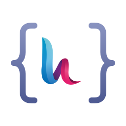

<p align="center">
  
</p>

<h1 align="center">HestiaCP PHP API</h1>

<p align="center">
  A modern PHP client for the <a href="https://hestiacp.com">HestiaCP</a> API.<br>
  Manage users, web domains, mail, databases and backups on a HestiaCP server from your PHP code.
</p>

<p align="center">
  <a href="https://packagist.org/packages/neto737/hestiacp-api"></a>
  <a href="https://packagist.org/packages/neto737/hestiacp-api"></a>
  
  <a href="https://github.com/neto737/HestiaCP-API/actions/workflows/tests.yml"></a>
  <a href="https://codecov.io/gh/neto737/HestiaCP-API"></a>
  <a href="LICENSE"></a>
</p>

---

## Features

- **Every HestiaCP login method:** access keys (HestiaCP 1.6+), legacy API keys, and admin username and password.
- **Ready-made modules** for users, web domains, mail, databases and backups.
- **Errors as exceptions:** each failure is a typed exception that carries HestiaCP's exit code, so you can tell "already exists" apart from "bad credentials".
- **TLS verification on by default,** with an option for self-signed certificates.
- **Plain PHP arrays** as results. The only dependency is Guzzle.
- **Lower-level access:** send any of the bundled command classes directly, or write your own.
- Tested on PHP 8.1 to 8.5 and checked against HestiaCP 1.10.

## Requirements

- PHP 8.1 or later
- HestiaCP with the API enabled, and the IP address of the calling machine allowed in the server settings

## Installation

```sh
composer require neto737/hestiacp-api
```

## Quick start

```php
use neto737\HestiaCP\Client;

// Access key (HestiaCP 1.6+), written as ACCESS_KEY:SECRET_KEY
$client = Client::simpleFactory('https://panel.example.com', 'ACCESS_KEY:SECRET_KEY');

// Check that the credentials work
$client->testAuthorization(); // bool

// List all users
$users = $client->getModuleUser()->list(); // ['admin' => ['NAME' => '...', 'CONTACT' => '...', ...], ...]

// Add a web domain for the admin user and give it a Let's Encrypt certificate
$web = $client->getModuleWeb('admin');
$web->addDomain('example.com');
$web->addDomainLetsEncrypt('example.com', 'www.example.com');

// Create a mailbox
$mail = $client->getModuleMail('admin');
$mail->addDomain('example.com');
$mail->addAccount('example.com', 'info', 'S3cure-Pa$$word');
```

> [!NOTE]
> TLS certificates are verified by default. If your panel still uses the self-signed certificate created at install, see [TLS certificates](docs/authentication.md#tls-certificates).

## Modules

| Module | Get it with | What it covers |
| --- | --- | --- |
| [Users](docs/users.md) | `getModuleUser()` | List, show, add and delete users. Change passwords, suspend and unsuspend, back up all users. |
| [Web domains](docs/web.md) | `getModuleWeb($user)` | Add, delete, suspend and unsuspend domains. Let's Encrypt certificates and FTP accounts. |
| [Mail](docs/mail.md) | `getModuleMail($user)` | Mail domains and accounts, passwords, suspending, DKIM keys and DNS records. |
| [Databases](docs/databases.md) | `getModuleDatabase($user)` | Create, list and delete databases. |
| [Backups](docs/backups.md) | `getModuleBackup($user)` | Create, list and delete backups. List and delete backup exclusions. |

Need a command that isn't wrapped in a module? See [Sending commands directly](docs/commands.md).

## Error handling

```php
use neto737\HestiaCP\Command\ResponseCode;
use neto737\HestiaCP\Exceptions\AuthorizationException;
use neto737\HestiaCP\Exceptions\ClientException;
use neto737\HestiaCP\Exceptions\ProcessException;

try {
	$client->getModuleUser()->add('jane', 'S3cure-Pa$$word', 'jane@example.com');
} catch (AuthorizationException $e) {
	// wrong credentials, or not allowed to run the command
} catch (ProcessException $e) {
	if ($e->getCode() === ResponseCode::E_EXISTS) {
		// the user already exists
	}
} catch (ClientException $e) {
	// connection problem: timeout, DNS, TLS, ...
}
```

All exception types and exit codes are listed in [Error handling](docs/errors.md).

## Documentation

- [Authentication and client setup](docs/authentication.md): access keys, legacy API keys, passwords, hostname rules, TLS and timeouts
- [Error handling](docs/errors.md): exception types and HestiaCP exit codes
- Modules: [Users](docs/users.md) · [Web domains](docs/web.md) · [Mail](docs/mail.md) · [Databases](docs/databases.md) · [Backups](docs/backups.md)
- [Sending commands directly](docs/commands.md): using the command classes, and writing your own

**Upgrading from v1?** Read [UPGRADING.md](UPGRADING.md). All changes are listed in [CHANGELOG.md](CHANGELOG.md).

## Contributing

Bug reports and pull requests are welcome. To run the checks:

```sh
composer install
composer check    # coding style, static analysis and tests
```

Each check can also run on its own: `composer test` (PHPUnit), `composer analyse` (PHPStan) and `composer cs` (PHP-CS-Fixer). `composer cs-fix` fixes the coding style. The code uses tabs for indentation and LF line endings.

The tests use Guzzle's mock handler, so they don't need a HestiaCP server.

## Credits

This library started as a fork of [ProfiCloS/vestacp-api](https://github.com/ProfiCloS/vestacp-api) by PROFI CLOUD SERVICES s.r.o., a client for VestaCP, and was adapted and extended for HestiaCP.

This is a community project. It is not affiliated with or endorsed by the HestiaCP project. The Hestia logo used in this project's logo is copyright [hestiacp.com](https://hestiacp.com) and is included unmodified.

## Support the project :heart:

If this library saves you time, you can support its development via [Liberapay](https://liberapay.com/neto737), [PayPal](https://paypal.me/neto737) or crypto:

```
BTC: bc1q89ntljt5lk7g9z68f5cjs83qfm2xme7g4hkur7
ETH: 0xeef9220639F14E7A0FD825AAAd0574e5a8aD7A4B
LTC: ltc1q508qfkd09vyya6c5zkfx4r248pf3ezj9ngjdr2
```

## License

Released under the [MIT License](LICENSE).
